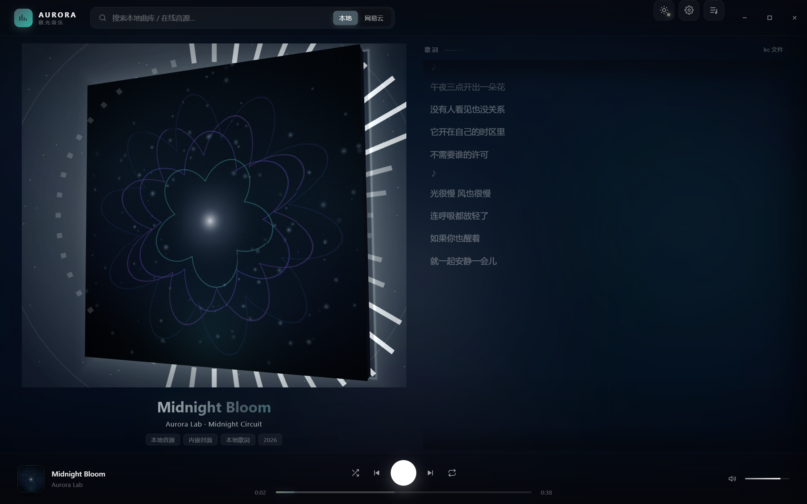
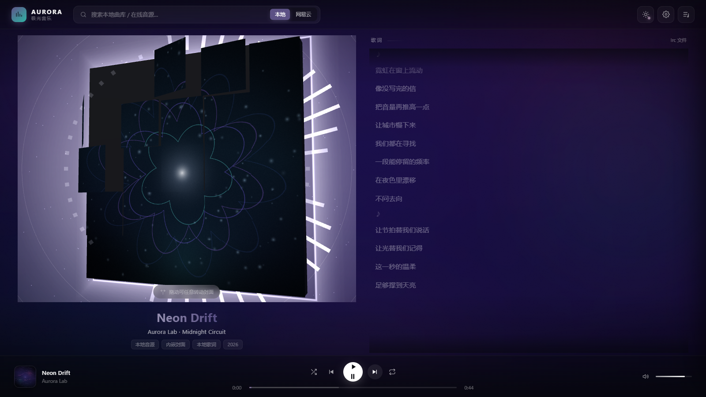
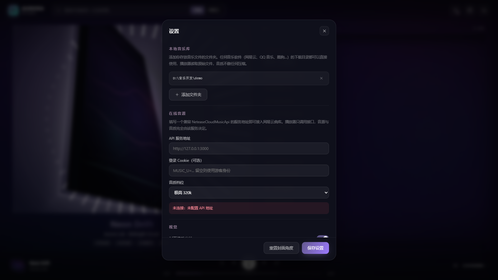

<div align="center">

# 🎵 AURORA 极光音乐

**基于 Electron 的双平台聚合桌面音乐播放器**

[](../../releases)
[](../../releases)
[](https://www.electronjs.org/)
[](LICENSE)

*网易云 + QQ 音乐 · 一台播放器，听遍两个平台*



</div>

---

## ✨ 核心特性

### 🎧 双平台聚合
- **网易云 + QQ 音乐**一次搜索同时出结果，徽章标注来源
- **账号隔离架构**：多设备并发登录互不串号（凭证随请求头透传，用完即弃）
- 游客也能搜：未登录时自动走多级公共搜索兜底

### 🌊 BPM 智能交叉淡化（Crossfade）
- 切歌不再"戛然而止"——上一首的尾声与下一首的开头**等功率平滑交叠**（约 4.5s）
- 播放器内嵌 BPM 节奏分析，运动场景下自动匹配节拍相近的下一首
- 纯原生音频实例实现，失败自动降级硬切，绝不卡死

### 🕹️ 像素伴侣
- 播放页右下角一只**像素小人**，随音乐律动起舞
- 收藏、切歌、暂停都有专属小动画



### 📖 沉浸式歌词
- 全屏沉浸歌词页，逐行高亮 + 点击跳播
- 外语歌自动挂载**翻译歌词**，中英对照
- 歌词滚动毛玻璃渐隐，焦点永远在当前句

### ☁️ 本地 · 云端双同步
- 本地歌单（IndexedDB）与平台歌单并存
- ❤️ 红心收藏 → 系统歌单"我喜欢"，实时增删
- **批量多选**：全选 / 批量删除 / 跨歌单移动
- 平台歌单浏览、云歌单拉取、最近播放 / 听歌排行统计

### 🔐 隐私优先设计
- 凭证**永不落明文**：桌面端 safeStorage 加密会话；云端部署只随请求头透传
- 播放直链 **302 直连 CDN**，音频字节不经服务器（省流量 + 低延迟）
- 游客搜索四层兜底，未登录也能搜出双平台曲库



---

## 🚀 快速开始

### 下载安装（推荐）

前往 [**Releases 页面**](../../releases) 下载最新安装包：

| 文件 | 说明 |
|---|---|
| `极光音乐-Setup-x.y.z.exe` | Windows 安装版（NSIS，支持自定义安装路径） |

双击安装即可，无需任何运行时依赖。

### 从源码运行

```bash
# 1. 克隆仓库
git clone https://github.com/gtlwhh/aurora-music-player.git
cd aurora-music-player

# 2. 安装依赖
npm install

# 3. 启动桌面应用（Electron）
npm start

# 或者只启动本地 BFF 服务（浏览器访问 http://127.0.0.1:7788）
npm run serve

# 4. 构建安装包（Windows）
npm run dist
```

### 登录账号

| 平台 | 方式 |
|---|---|
| 网易云 | 设置页粘贴 Cookie（`MUSIC_U=...`），或扫码登录 |
| QQ 音乐 | 设置页扫码登录（凭证加密存储于本机） |

> 不登录也可以用：游客态可搜索、可试听，双平台曲库都能浏览。

### 启动播放器.bat（免安装快速体验）

开发模式下也可以双击 **`启动播放器.bat`**——首次运行自动装依赖，之后秒开。

---

## 🏗️ 项目结构

```
aurora-music-player/
├── electron/          # Electron 主进程（窗口、生命周期、服务托管）
├── server/            # 本地 BFF 服务（Node 原生 HTTP，无框架）
│   ├── index.js       # 路由与业务入口
│   ├── providers/     # 网易云 / QQ 音源适配器
│   └── lib/           # 凭证上下文（ALS）、会话、缓存
├── web/               # 前端界面（原生 ES Module，无构建步骤）
├── core/              # 双端共享核心（播放统计、本地歌单、BPM 分析）
├── docs/              # 截图与部署文档
└── tools/             # 辅助脚本
```

**技术栈**：Electron 44 · Node 原生 HTTP（零框架）· 原生 ES Module 前端 · IndexedDB · safeStorage 加密 · AsyncLocalStorage 凭证隔离

---

## 🛡️ 架构亮点

<details>
<summary><b>凭证隔离：根治"多用户串号"</b></summary>

早期版本把 Cookie/Token 缓存在 provider 单例的实例字段上——两个用户并发时后到者覆盖先到者，导致 A 听到 B 的歌单。

现在凭证只存在于**当前请求的 AsyncLocalStorage 上下文**：HTTP 入口用 `als.run({ ncm, qq }, ...)` 包住整个路由处理，provider 在任意深度的 `await` 之后读到的都是"自己这次请求"的凭证，用完即弃。

后台异步任务（如推荐队列补货）通过 **ALS 上下文快照**透传凭证——`setTimeout` 里凭证不蒸发。

</details>

<details>
<summary><b>双平台推荐：严格拉链式交替</b></summary>

心动模式 / 私人漫游的推荐队列由网易云 + QQ 双侧并供给：两侧数量配平后**严格 A₁→B₁→A₂→B₂ 交替**，一侧数量不足自动用该平台全局推荐补齐；单侧彻底不可用时才降级单平台，且每层失败原因完整记录日志。

</details>

<details>
<summary><b>游客搜索：四层兜底</b></summary>

未登录 / 机房 IP 被风控时，搜索自动逐级降级：内嵌协议搜索（匿名精简版身份）→ 缓存的游客令牌 → 公共 soso 接口 → GD 公共搜索。任何一层出结果即返回。

</details>

---

## ⚠️ 免责声明

本项目仅供学习与技术研究使用。音乐版权归 **网易云音乐** 与 **腾讯 QQ 音乐** 所有，请支持正版。请勿用于任何商业用途。

---

<div align="center">

**如果这个项目对你有帮助，欢迎点个 ⭐ Star**

Made with 💜 by [gtlwhh](https://github.com/gtlwhh)

</div>
